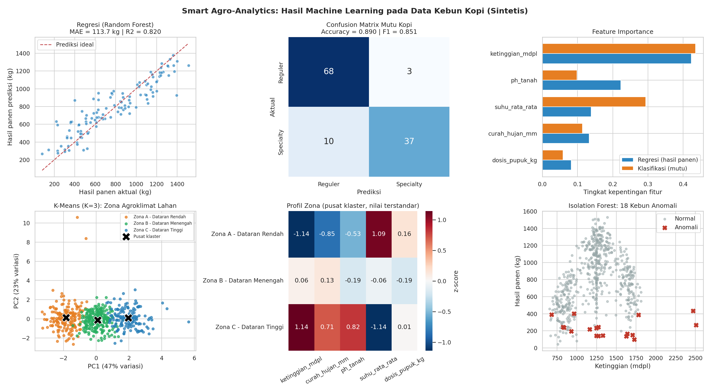

# Smart Agro-Analytics

**Prediksi Hasil Panen, Klasifikasi Mutu Biji Kopi, dan Klasterisasi Lahan Petani Lokal Menggunakan Machine Learning**


Proyek tugas kuliah **Introduction to Machine Learning** yang menerapkan seluruh alur kerja machine learning (6 tahap) pada studi kasus perkebunan kopi lokal. Proyek ini mengacu pada materi *Introduction to Machine Learning* oleh Dr. Taniza Tajuddin yang mencakup *Data-Driven Thinking*, 6 tahap ML Workflow, *Supervised Learning* (Regression dan Classification), serta *Unsupervised Learning* (K-Means Clustering dan Anomaly Detection).

> **Catatan:** seluruh data pada repositori ini adalah **data sintetis** yang dibangkitkan oleh program untuk tujuan pembelajaran. Hasil dan angka evaluasi **tidak** mewakili kondisi kebun kopi yang sebenarnya.

---

## Daftar Isi

1. [Latar Belakang Studi Kasus](#latar-belakang-studi-kasus)
2. [Mengapa Data-Driven (ML), Bukan Rule-Based Programming?](#mengapa-data-driven-ml-bukan-rule-based-programming)
3. [Dataset](#dataset)
4. [Penjelasan 6 Tahapan ML Workflow di dalam Kode](#penjelasan-6-tahapan-ml-workflow-di-dalam-kode)
5. [Hasil Evaluasi Model](#hasil-evaluasi-model)
6. [Panduan Menjalankan Program](#panduan-menjalankan-program)
7. [Struktur Repositori](#struktur-repositori)
8. [Keterbatasan dan Pengembangan Lanjutan](#keterbatasan-dan-pengembangan-lanjutan)

---

## Latar Belakang Studi Kasus

Kopi adalah komoditas penting bagi banyak petani di Indonesia, termasuk di wilayah dataran tinggi Sumatera. Petani kopi skala kecil menghadapi tiga pertanyaan praktis yang saling berkaitan:

1. **Berapa hasil panen yang bisa diharapkan** dari sebuah lahan, mengingat ketinggian, curah hujan, keasaman tanah, suhu, dan dosis pupuk?
2. **Apakah biji kopi dari lahan tersebut berpeluang masuk kelas *Specialty*** (harga jual lebih tinggi) atau hanya kelas *Reguler*?
3. **Lahan mana yang punya karakter serupa** sehingga dapat dikelola dengan strategi yang sama, dan **lahan mana yang kondisinya tidak wajar** (misalnya terindikasi serangan hama atau kerusakan tanah) dan perlu segera dicek?

Proyek **Smart Agro-Analytics** menjawab ketiganya dengan machine learning:

| Pertanyaan | Jenis Masalah ML | Metode |
|---|---|---|
| Prediksi hasil panen (kg) | Supervised - Regression | Random Forest Regressor (pembanding: Linear Regression) |
| Klasifikasi mutu kopi | Supervised - Classification | Random Forest Classifier |
| Pengelompokan lahan menjadi zona agroklimat | Unsupervised - Clustering | K-Means (K=3) |
| Deteksi kebun berkondisi ekstrem | Unsupervised - Anomaly Detection | Isolation Forest |

---

## Mengapa Data-Driven (ML), Bukan Rule-Based Programming?

Pada **rule-based programming**, programmer menuliskan aturan secara manual, misalnya:

```python
if ketinggian > 1400 and ph_tanah > 5.8:
    mutu = "Specialty"
else:
    mutu = "Reguler"
```

Pada **pendekatan data-driven (ML)**, programmer menyediakan **data dan jawabannya**, lalu algoritma **mempelajari sendiri aturannya**. Untuk kasus kopi ini, pendekatan data-driven lebih sesuai karena:

| Aspek | Rule-Based | Data-Driven (ML) |
|---|---|---|
| Sumber aturan | Ditulis manual oleh ahli/programmer | Dipelajari otomatis dari data |
| Hubungan non-linear | Sulit dituliskan. Hasil panen naik lalu turun di sekitar kondisi optimum (kurva lonceng), bukan garis lurus | Random Forest menangkap pola non-linear tanpa rumus eksplisit |
| Banyak faktor sekaligus | Aturan `if-else` membengkak dan saling bertabrakan | Model menimbang 5 fitur secara bersamaan |
| Ambang batas | Angka ambang ditentukan dengan menebak (mengapa 1400 mdpl, bukan 1350?) | Batas keputusan diturunkan dari data |
| Adaptasi | Setiap perubahan kondisi harus menulis ulang aturan | Cukup melatih ulang dengan data baru |
| Penemuan pola baru | Hanya menemukan yang sudah dipikirkan programmer | Clustering dan anomaly detection menemukan pola tanpa label |
| Ketidakpastian | Keluaran pasti (ya/tidak) | Dapat memberi probabilitas, misalnya "82% Specialty" |

Bukti sederhana ada pada hasil proyek ini: model **Linear Regression** (hubungan garis lurus, mirip aturan sederhana) hanya mencapai R2 sekitar 0,08, sedangkan **Random Forest** yang belajar pola non-linear dari data mencapai R2 sekitar 0,82 pada data yang sama.

Pendekatan ML tetap punya syarat: kualitas data harus baik, hasil perlu dievaluasi pada data yang belum pernah dilihat model, dan keputusan penting tetap perlu dikonfirmasi oleh ahli di lapangan.

---

## Dataset

Dataset dibangkitkan otomatis oleh fungsi `buat_dataset()` (seed tetap sehingga dapat direproduksi) dan disimpan sebagai `dataset_kebun_kopi.csv`.

| Kolom | Peran | Keterangan |
|---|---|---|
| `ketinggian_mdpl` | Fitur | Ketinggian lahan (meter di atas permukaan laut) |
| `curah_hujan_mm` | Fitur | Curah hujan tahunan (mm/tahun) |
| `ph_tanah` | Fitur | Derajat keasaman tanah |
| `suhu_rata_rata` | Fitur | Suhu rata-rata harian (derajat Celsius) |
| `dosis_pupuk_kg` | Fitur | Dosis pupuk (kg per hektar per tahun) |
| `hasil_panen_kg` | Target regresi | Hasil panen biji hijau (kg per hektar per musim) |
| `mutu_kopi` | Target klasifikasi | `Specialty` atau `Reguler` |

Total **600 baris**. Agar menyerupai data lapangan, dataset sengaja dibuat "kotor":

- **Missing value**: sekitar 5% sel pada kolom fitur dikosongkan (NaN).
- **Duplikat**: 12 baris tercatat dua kali.
- **Outlier/anomali**: 10 kebun berkondisi ekstrem (serangan hama, tanah sangat asam, ketinggian ekstrem, pemupukan berlebihan, curah hujan ekstrem). Penanda anomali ini **hanya dipakai untuk validasi** di Tahap 5b dan tidak pernah dipakai untuk melatih model.

---

## Penjelasan 6 Tahapan ML Workflow di dalam Kode

Seluruh tahap ada pada `smart_coffee_ml.py` dan dijalankan berurutan oleh fungsi `main()`.

| Tahap | Fungsi di Kode | Penjelasan |
|---|---|---|
| **1. Data Collection** | `buat_dataset()`, `tahap1_data_collection()` | Membangkitkan 600 data lahan sintetis lengkap dengan missing value, duplikat, dan outlier. Menampilkan data awal dan statistik deskriptif (*exploratory data analysis* sederhana). |
| **2. Data Preprocessing** | `tahap2_preprocessing_awal()`, `tahap2_lanjutan_imputasi_scaling()` | Menghitung missing value, **menghapus duplikat**, **encoding label** (`Reguler`=0, `Specialty`=1), **imputasi median**, dan **StandardScaler**. |
| **3. Data Splitting** | `tahap3_splitting()` | Membagi data **80% training : 20% testing** dengan `stratify` agar proporsi kelas Specialty/Reguler sama di kedua bagian. |
| **4. Supervised Learning** | `tahap4a_regresi()`, `tahap4b_klasifikasi()` | Regresi hasil panen (MAE, R2) dan klasifikasi mutu kopi (Accuracy, Precision, Recall, F1, Confusion Matrix), ditambah validasi silang 5-fold. |
| **5. Unsupervised Learning** | `tahap5a_clustering()`, `tahap5b_anomaly()`, `tahap5c_visualisasi()` | K-Means (K=3) membentuk zona agroklimat **tanpa melihat label**, Isolation Forest mendeteksi kebun anomali, dan hasilnya divisualisasikan ke `visualisasi_ml_kopi.png`. |
| **6. Inference** | `tahap6_inference()` | Memprediksi hasil panen, mutu, zona, dan status kewajaran untuk satu kebun baru milik petani. |

### Catatan penting: urutan Tahap 2 dan Tahap 3

Pembersihan data yang tidak bergantung pada statistik data (hapus duplikat dan encoding label) dilakukan **sebelum** pembagian data. Sebaliknya, **imputasi median dan StandardScaler di-fit hanya pada data training**, lalu diterapkan ke data testing. Itulah sebabnya pada keluaran program muncul "Tahap 2 (lanjutan)" setelah Tahap 3.

Alasannya adalah mencegah ***data leakage***: jika median dan rata-rata dihitung dari seluruh data (termasuk data testing), informasi dari data testing "bocor" ke proses training sehingga evaluasi menjadi terlalu optimistis. Pipeline yang sama juga dipakai ulang pada Tahap 6 untuk kebun baru.

---

## Hasil Evaluasi Model

Hasil di bawah berasal dari satu kali eksekusi dengan `RANDOM_STATE = 42` (data bersih 588 baris: 470 training, 118 testing). Angka dapat sedikit berbeda jika versi library berbeda.



### Tahap 4a - Regresi hasil panen

| Model | MAE (kg) | R2 Score |
|---|---|---|
| Linear Regression (baseline) | 293,15 | 0,0774 |
| **Random Forest Regressor** | **113,69** | **0,8205** |

R2 validasi silang 5-fold pada data training: 0,7167 +/- 0,0590.

**Interpretasi:** rata-rata prediksi Random Forest meleset sekitar 114 kg dari hasil panen aktual, dan model menjelaskan sekitar 82% variasi hasil panen. Linear Regression gagal karena hubungan antara kondisi lahan dan hasil panen bersifat non-linear (ada titik optimum). Selisih R2 antara validasi silang (0,72) dan data testing (0,82) menunjukkan bahwa angka pada data testing sebaiknya dibaca sebagai perkiraan, bukan nilai pasti.

### Tahap 4b - Klasifikasi mutu kopi (kelas positif: Specialty)

| Metrik | Nilai |
|---|---|
| Accuracy | 0,8898 |
| Precision | 0,9250 |
| Recall | 0,7872 |
| F1-Score | 0,8506 |

Accuracy validasi silang 5-fold pada data training: 0,8830 +/- 0,0150.

**Confusion Matrix** (data testing, 118 kebun):

| | Prediksi Reguler | Prediksi Specialty |
|---|---|---|
| **Aktual Reguler** | 68 | 3 |
| **Aktual Specialty** | 10 | 37 |

**Interpretasi:** saat model menyebut sebuah kebun *Specialty*, 92,5% benar (precision tinggi). Namun model melewatkan sekitar 21% kebun *Specialty* yang sebenarnya (recall 0,79), yang diprediksi sebagai *Reguler*. Jika tujuannya jangan sampai ada lahan berpotensi Specialty yang terlewat, ambang keputusan dapat diturunkan atau model dapat dituning untuk meningkatkan recall.

### Tahap 5a - K-Means Clustering (K=3)

Silhouette Score: **0,2158**. Nilai ini rendah-sedang, artinya zona saling tumpang tindih. Hal ini wajar karena kondisi lahan berubah secara bertahap (gradien ketinggian), bukan terpisah tegas.

| Karakteristik (rata-rata) | Zona A - Dataran Rendah | Zona B - Dataran Menengah | Zona C - Dataran Tinggi |
|---|---|---|---|
| Jumlah lahan | 182 | 247 | 159 |
| Ketinggian (mdpl) | 889 | 1.258 | 1.593 |
| Curah hujan (mm) | 1.659 | 2.042 | 2.270 |
| pH tanah | 5,62 | 5,78 | 6,27 |
| Suhu (derajat C) | 22,8 | 20,3 | 18,0 |
| Rata-rata hasil panen (kg) | 556 | 1.023 | 765 |
| Persentase Specialty | 0,0% | 36,0% | 91,2% |

**Interpretasi:** K-Means hanya melihat lima fitur lahan, namun zona yang terbentuk ternyata berbeda jelas dalam hasil panen dan mutu: dataran menengah paling produktif, sedangkan dataran tinggi paling banyak menghasilkan kopi Specialty. Kolom hasil panen dan persentase Specialty dipakai **setelah** clustering hanya untuk menafsirkan zona.

### Tahap 5b - Anomaly Detection (Isolation Forest)

- Parameter `contamination = 0.03` (asumsi sekitar 3% kebun berkondisi ekstrem).
- **18 dari 588 kebun** ditandai anomali.
- Validasi terhadap 10 anomali yang disisipkan di Tahap 1: **8 dari 10 terdeteksi** (recall 0,80, presisi 0,44).

**Interpretasi:** dua anomali yang terlewat adalah kasus "hama" yang kondisi lahannya tampak normal dan hanya hasil panennya yang anjlok. Presisi rendah karena beberapa kebun dengan nilai ekstrem alami (misalnya curah hujan sangat rendah atau pH sangat tinggi) ikut ditandai. Dalam praktik, kebun yang ditandai anomali adalah **kandidat pemeriksaan lapangan**, bukan vonis.

### Tahap 6 - Inference (kebun baru)

Masukan: ketinggian 1.380 mdpl, curah hujan 1.950 mm, pH 6,0, suhu 19,6 derajat C, pupuk 160 kg.

| Keluaran | Hasil |
|---|---|
| Prediksi hasil panen | sekitar 1.340 kg per hektar |
| Prediksi mutu | **Specialty** (probabilitas 82,3%; Reguler 17,7%) |
| Zona agroklimat | Zona B - Dataran Menengah |
| Status kondisi kebun | Normal |

---

## Panduan Menjalankan Program

### Prasyarat

- Python 3.10 atau lebih baru (diuji pada Python 3.12)
- pip

### Langkah-langkah

1. **Clone repositori** (atau ekstrak file zip), lalu masuk ke foldernya:

   ```bash
   git clone <url-repositori-anda>
   cd smart-agro-analytics
   ```

2. **(Disarankan) Buat virtual environment:**

   ```bash
   python -m venv .venv
   # Linux/macOS
   source .venv/bin/activate
   # Windows
   .venv\Scripts\activate
   ```

3. **Instal dependensi:**

   ```bash
   pip install -r requirements.txt
   ```

4. **Jalankan program:**

   ```bash
   python smart_coffee_ml.py
   ```

Program berjalan sekitar 10 detik pada komputer biasa dan mencetak keluaran setiap tahap ke terminal.

### Berkas yang dihasilkan

| Berkas | Isi |
|---|---|
| `visualisasi_ml_kopi.png` | Enam panel: regresi, confusion matrix, feature importance, K-Means, profil zona, anomaly detection |
| `dataset_kebun_kopi.csv` | Dataset sintetis yang digunakan (tanpa penanda anomali validasi) |

### Mengubah eksperimen

Parameter utama berada di bagian atas `smart_coffee_ml.py` dan pada fungsi tiap tahap, misalnya `RANDOM_STATE`, `n_estimators` pada Random Forest, `contamination` pada Isolation Forest, dan data `kebun_baru` pada `tahap6_inference()`.

---

## Struktur Repositori

```
.
├── smart_coffee_ml.py        # program utama (6 tahap ML Workflow)
├── requirements.txt          # daftar dependensi
├── README.md                 # dokumentasi ini
├── dataset_kebun_kopi.csv    # dataset sintetis (dihasilkan otomatis)
└── visualisasi_ml_kopi.png   # grafik hasil (dihasilkan otomatis)
```

---

## Keterbatasan dan Pengembangan Lanjutan

**Keterbatasan**

- Data **sintetis**: hubungan antar variabel ditentukan oleh rumus buatan, sehingga performa model kemungkinan **lebih baik** daripada pada data lapangan yang lebih berisik.
- Ukuran data kecil (588 baris setelah pembersihan), sehingga hasil pada data testing (118 baris) bisa berubah cukup besar jika pembagian data diubah.
- `ketinggian_mdpl` dan `suhu_rata_rata` berkorelasi sangat kuat, sehingga kontribusi kedua fitur tersebut pada *feature importance* saling berbagi dan perlu ditafsirkan hati-hati.
- Outlier tetap dipertahankan saat melatih model supervised (Random Forest relatif tahan terhadap outlier). Alternatifnya adalah menyaring anomali terlebih dahulu.
- Jumlah klaster K=3 ditetapkan dari soal. Pada data nyata, K sebaiknya dipilih dengan metode elbow atau silhouette.

**Pengembangan lanjutan**

- Memakai data nyata (misalnya data survei petani, stasiun cuaca, dan uji laboratorium tanah).
- Tuning hyperparameter dengan `GridSearchCV` atau `RandomizedSearchCV`, serta mencoba model lain (Gradient Boosting, XGBoost).
- Menyimpan model terlatih (`joblib`) dan membuat aplikasi web sederhana (Streamlit atau Flask) agar petani dapat memasukkan data kebun mereka sendiri.
- Menambahkan fitur lain seperti varietas kopi, umur tanaman, dan teknik pascapanen.

---

## Lisensi

Dibuat untuk keperluan akademik (tugas kuliah). Silakan digunakan dan dimodifikasi untuk pembelajaran.
